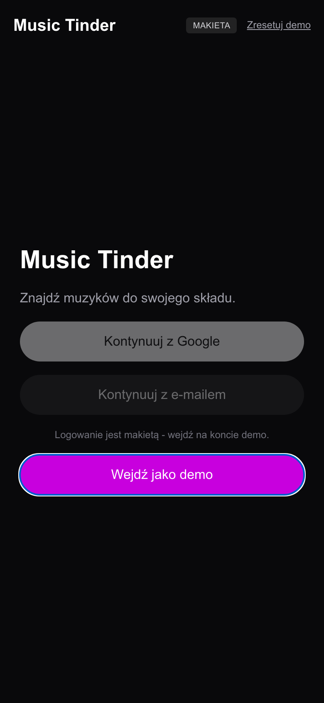
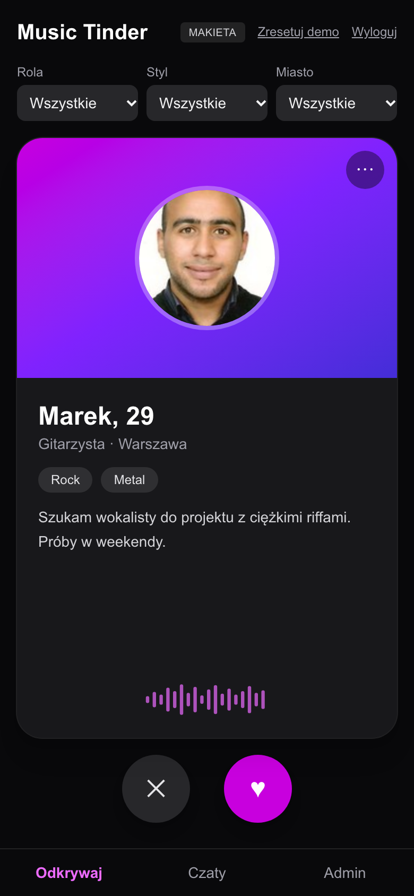
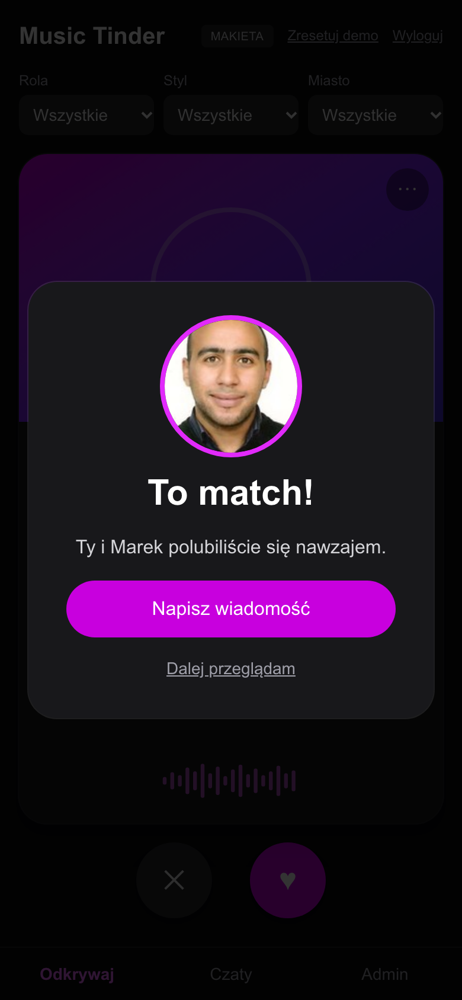
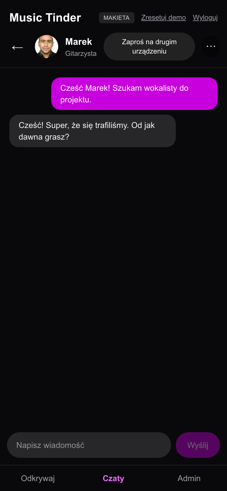
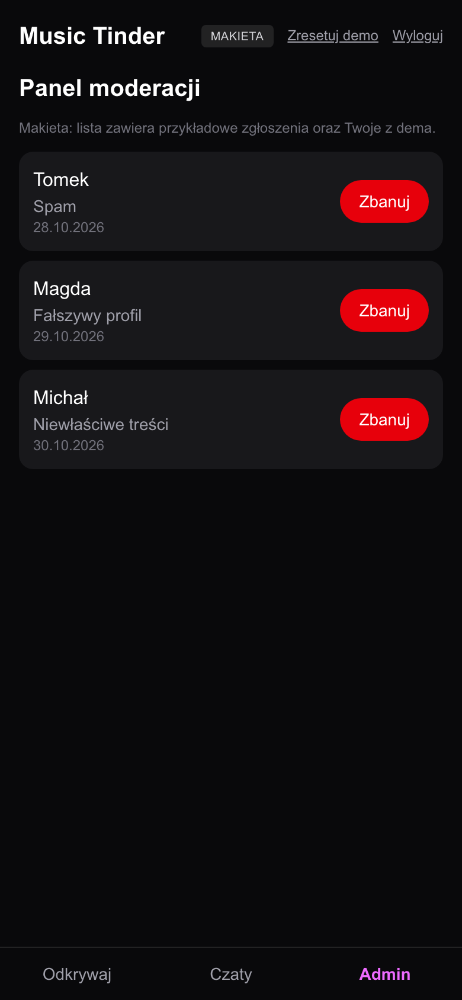

# Music Tinder (makieta)

Mobile-first PWA: networking dla muzyków - swipe, match i czat 1:1 w czasie rzeczywistym. To makieta pokazująca główny flow produktu i jakość kodu. Profile są zhardcodowane, a zdjęcia poglądowe (fikcyjne osoby).

**Demo:** https://music-tinder-ten.vercel.app (najlepiej na telefonie lub w widoku mobilnym)

**Kod:** https://github.com/Safeheaded/music-tinder

| Logowanie                         | Odkrywanie                           | Match                             | Czat                             | Admin                             |
| --------------------------------- | ------------------------------------ | --------------------------------- | -------------------------------- | --------------------------------- |
|  |  |  |  |  |

## Co działa w makiecie

- Swipe kart (przeciąganie lub przyciski ✕ / ♥) z filtrami: rola, styl muzyczny, miasto.
- Match, gdy polubiony profil "lubi Cię z powrotem" (połowa profili). Po matchu rozmowa 1:1.
- Czat w czasie rzeczywistym przez Supabase Realtime (Broadcast i Presence). Bez drugiej osoby w pokoju odpowiada bot scenariuszowy, więc demo nie jest puste.
- Zgłaszanie i blokowanie profili, prosty panel `/admin` z listą zgłoszeń i banowaniem.
- Instalowalna PWA (manifest, ikony, service worker).

Zaplecze jest atrapą: logowanie (e-mail i Google), baza danych i embedy mediów **nie są** w makiecie zaimplementowane. Opis tych części znajdziesz niżej w sekcji "Pełna wersja".

## Jak przetestować czat na dwóch urządzeniach

1. Wejdź na demo, kliknij "Wejdź jako demo", polub profil, który odwzajemnia polubienie (np. Marek), i otwórz rozmowę.
2. Kliknij "Zaproś na drugim urządzeniu". Aplikacja utworzy prywatny pokój (`?room=...`) i skopiuje link.
3. Otwórz link na drugim urządzeniu. Wiadomości pojawiają się u obu osób na żywo, a bot milknie, gdy w pokoju jest człowiek.

Uwagi: pokój identyfikuje kod z linku (to zabezpieczenie na poziomie dema, nie kontrola dostępu), a Broadcast nie buforuje wiadomości, więc wiadomość wysłana w pierwszej sekundzie po dołączeniu drugiej osoby może zginąć. Bez kodu pokoju czat działa tylko z botem.

## Uruchomienie lokalnie

```bash
pnpm install
cp .env.example .env.local   # opcjonalnie: klucze Supabase
pnpm dev
```

Bez kluczy `NEXT_PUBLIC_SUPABASE_URL` i `NEXT_PUBLIC_SUPABASE_ANON_KEY` czat działa wyłącznie z botem. Klucze pochodzą z darmowego projektu Supabase (wystarcza Realtime Broadcast, bez tabel).

## Skrypty

| Komenda                       | Działanie                                              |
| ----------------------------- | ------------------------------------------------------ |
| `pnpm check`                  | typy, lint i testy jednostkowe                         |
| `pnpm test`                   | testy jednostkowe (Vitest, Testing Library)            |
| `pnpm e2e`                    | testy E2E (Playwright), budują i uruchamiają aplikację |
| `E2E_BASE_URL=<url> pnpm e2e` | testy E2E na wdrożonym adresie                         |
| `pnpm format`                 | formatowanie (Prettier)                                |

Husky uruchamia przed każdym commitem lint-staged, sprawdzenie typów i testy.

## Stack

Next.js (App Router), TypeScript (strict), Tailwind CSS, Zustand, Zod, framer-motion, Supabase Realtime, Vitest, Playwright, Vercel.

## Jakość i rozszerzalność kodu

- Struktura feature-based: `src/features/{auth,discover,chat,moderation,admin}`. Każdy feature ma publiczne `index.ts`, a ESLint zabrania importów z jego wnętrza.
- Warstwy: UI → hooki → `api/` / `transports/` → klient. Supabase importuje wyłącznie `lib/supabase` i foldery `api/` oraz `transports/` (też egzekwowane w ESLint).
- Czat zależy od interfejsu `ChatTransport`, a nie od konkretnej technologii. Dzięki temu bot, Supabase Broadcast i przyszła wersja z bazą danych są wymienne bez zmian w UI ([ADR 0001](docs/adr/0001-chat-transport.md), [ADR 0002](docs/adr/0002-private-chat-rooms.md)).
- Dane zewnętrzne walidowane Zod, wszystkie teksty UI w jednym pliku (`src/messages/pl.ts`), co ułatwia dodanie i18n.
- Konwencje, warstwy i punkty rozszerzeń: [`AGENTS.md`](AGENTS.md) i [`docs/ARCHITECTURE.md`](docs/ARCHITECTURE.md).

## Pełna wersja: co dochodzi względem makiety

### Autoryzacja i profile

Supabase Auth: e-mail z hasłem lub magic link oraz Google OAuth. Profil użytkownika (nazwa, rola, style, miasto, bio, zdjęcie w Supabase Storage) i do 3 linków do mediów.

### Media (wyłącznie iFrame / oEmbed)

Parser URL → embed z listą dozwolonych domen (Spotify, SoundCloud, YouTube). Brak uploadu plików audio. Linki walidowane po stronie serwera (Zod), a embed renderowany w `iframe` z atrybutem `sandbox`.

### Model danych (Postgres)

| Tabela        | Najważniejsze kolumny                                                                           |
| ------------- | ----------------------------------------------------------------------------------------------- |
| `profiles`    | `id` (= `auth.users.id`), `name`, `role`, `city`, `genres[]`, `bio`, `avatar_path`, `is_banned` |
| `media_links` | `profile_id`, `provider`, `url`                                                                 |
| `swipes`      | `swiper_id`, `target_id`, `direction`, unikalne `(swiper_id, target_id)`                        |
| `matches`     | `user_a`, `user_b` (uporządkowane), tworzone triggerem po wzajemnym polubieniu                  |
| `messages`    | `match_id`, `sender_id`, `body`, `created_at`                                                   |
| `blocks`      | `blocker_id`, `blocked_id`                                                                      |
| `reports`     | `reporter_id`, `target_id`, `reason`, `status`                                                  |

Match powstaje w funkcji SQL (trigger na `swipes`), a nie po stronie klienta, więc nie da się go sfałszować.

### Bezpieczeństwo (RLS na każdej tabeli)

- `profiles`: odczyt dla zalogowanych poza zablokowanymi i zbanowanymi, zapis tylko właściciela.
- `swipes`: wstawianie wyłącznie jako własny `swiper_id`.
- `messages`: odczyt i zapis tylko przez uczestników `match`, brak wiadomości przy blokadzie.
- `reports` i panel admina: dostęp dla roli `admin` (claim w JWT lub tabela ról).

### Czat

Transport oparty na bazie: wiadomości zapisywane w `messages`, dostarczane przez Supabase Realtime (Postgres Changes) z historią i licznikiem nieprzeczytanych. W kodzie wystarczy dodać kolejną implementację `ChatTransport`.

### Moderacja i admin

Zgłoszenia ze statusami (nowe / rozpatrzone), blokowanie użytkowników, banowanie z poziomu panelu, prosty audyt akcji.

## Propozycja kamieni milowych (do potwierdzenia)

Estymata dla jednej osoby, z odbiorem technicznym po każdym etapie. Zakres i terminy ustalamy po przekazaniu projektu z Figmy i User Stories.

| #   | Kamień milowy           | Zakres                                                                                 | Czas         |
| --- | ----------------------- | -------------------------------------------------------------------------------------- | ------------ |
| 1   | Fundament i autoryzacja | Szkielet, CI, schemat bazy z RLS, e-mail + Google, profile                             | ok. 1,5 tyg. |
| 2   | Media                   | Parser oEmbed z whitelistą, widgety Spotify / SoundCloud / YouTube na profilu i karcie | ok. 1 tyg.   |
| 3   | Swipe, match, filtry    | Karty z gestami, filtry po stylu, roli i mieście, trigger matcha                       | ok. 1,5 tyg. |
| 4   | Czat 1:1                | Realtime na bazie, historia, nieprzeczytane, stany błędów                              | ok. 1 tyg.   |
| 5   | Moderacja i admin       | Blokowanie, zgłoszenia, panel admina                                                   | ok. 1 tyg.   |
| 6   | PWA, QA, wdrożenie      | Instalowalność, testy E2E, dostępność, wdrożenie produkcyjne, dokumentacja             | ok. 1 tyg.   |

Razem ok. 7 tygodni, a po wdrożeniu 30 dni gwarancji.

## Zdjęcia

Zdjęcia profili w `public/avatars/` pochodzą z puli `randomuser.me` i przedstawiają fikcyjne osoby. Służą wyłącznie jako ilustracja w makiecie i przed jakimkolwiek użyciem komercyjnym należy je wymienić na własne lub licencjonowane.
